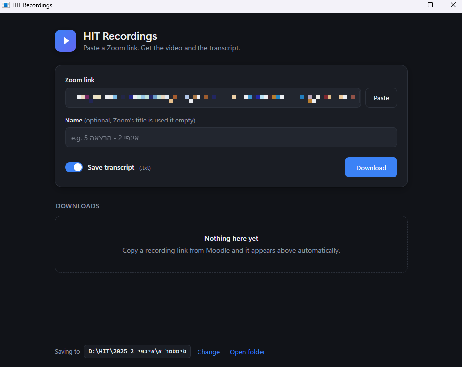
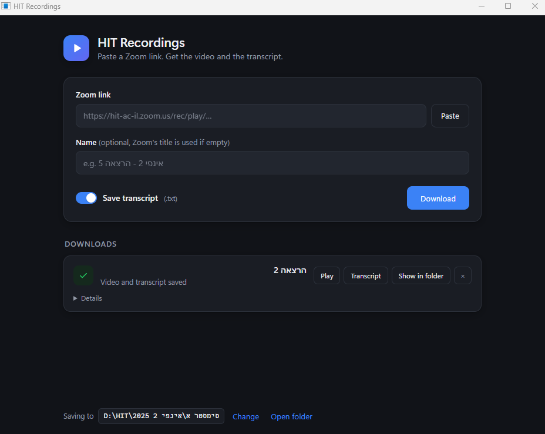
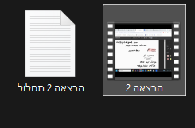

<div dir="rtl">

# HIT Student

כל מה שצריך בשביל הלימודים ב-HIT, באפליקציה אחת:

- **הקורסים שלי מה-Moodle**: כל קורס עם כל ההרצאות, הקבצים, המטלות וההקלטות שלו.
- **"הורד הכל" לכל שיעור**: המצגות, התרגילים, הקלטת ה-Zoom והתמלול בעברית נשמרים בתיקייה מסודרת במחשב.
- **"סכם עם Claude"**: בונה דף לימוד לשיעור, עם הנוסחאות, מה חשוב ומה אפשר לדלג, דפוסי שאלות, ורמזים לכל תרגיל.
- **צ'אט עם Claude על הקורס**: שואלים על החומר ומקבלים עזרה בשיעורי הבית, על סמך הקבצים שהורדת.
- **הורדת הקלטות Zoom בודדות**: מדביקים קישור ומקבלים את הסרטון ואת התמלול.

## התקנה

1. נכנסים ל-[Releases](../../releases) ומורידים את `HIT-Student.zip`.
2. מחלצים לתיקייה כלשהי (למשל `D:\HIT`).
3. מפעילים את `HitStudent.exe`.

בפעם הראשונה ש-Windows מציג "Windows protected your PC", לוחצים **More info** ואז **Run anyway**. ההודעה מופיעה כי התוכנה לא חתומה דיגיטלית.

## חיבור ל-Moodle

בפתיחה הראשונה נפתח דף ההתחברות של HIT בתוך האפליקציה. מתחברים פעם אחת עם שם המשתמש והסיסמה של HIT, והאפליקציה זוכרת את ההתחברות, גם ל-Moodle וגם ל-Zoom.

## חיבור ל-Claude

הסיכומים והצ'אט עובדים עם [Claude Code](https://claude.com/claude-code), דרך חשבון Claude של כל משתמש:

1. בלשונית **הגדרות** לוחצים **התקן Claude Code**. נפתח חלון שמתקין אותו.
2. לוחצים **התחבר ל-Claude** ומתחברים לחשבון Claude שלכם בחלון שנפתח. אחר כך סוגרים אותו.
3. לוחצים **בדוק שוב**. כשכתוב "מחובר", הכל מוכן.

בפעם הראשונה ש"סכם עם Claude" רץ, האפליקציה מתקינה לבד Python ו-PyMuPDF אם הם חסרים.

## איך זה מסודר במחשב

```
D:\HIT\Courses\
  <שם הקורס>\
    שיעור 1\              מצגות וקבצים
      תרגילים\            תרגילים, פתרונות ומטלות
      הקלטה\              שיעור 1.mp4 + שיעור 1 תמלול.txt
    שיעור 2\ ...
    דפי לימוד\
      שבוע-1.html         דף הלימוד ש-Claude בנה
```

אפשר לשנות את התיקייה בהגדרות.

## צילומי מסך (הורדת הקלטות)







## פרטיות

- ההתחברות ל-HIT, ל-Moodle ול-Zoom נשמרת רק במחשב שלך, בתיקייה `browser-data` שליד האפליקציה. אל תשתפו אותה.
- Claude רץ עם החשבון שלך ורואה רק את תיקיית הקורס שבה הוא עובד.

## שימוש הוגן

הכלי נועד ללמידה אישית. אם מרצה כיבה את הורדת ההקלטות, כבדו את זה: אל תפיצו ואל תעלו את ההקלטות או את חומרי הקורס לשום מקום.

## קרדיט

הסקיל שבונה את דפי הלימוד (`skill/course-study-builder`) נכתב על ידי ariel853 ונכלל כאן באישורו.

## בנייה מהקוד

```powershell
powershell -ExecutionPolicy Bypass -File build.ps1
```

הסקריפט מוריד את ה-WebView2 SDK של Microsoft, מקמפל עם הקומפיילר של .NET Framework שמגיע עם Windows, ושם את התוצאה ב-`dist\`.

</div>
