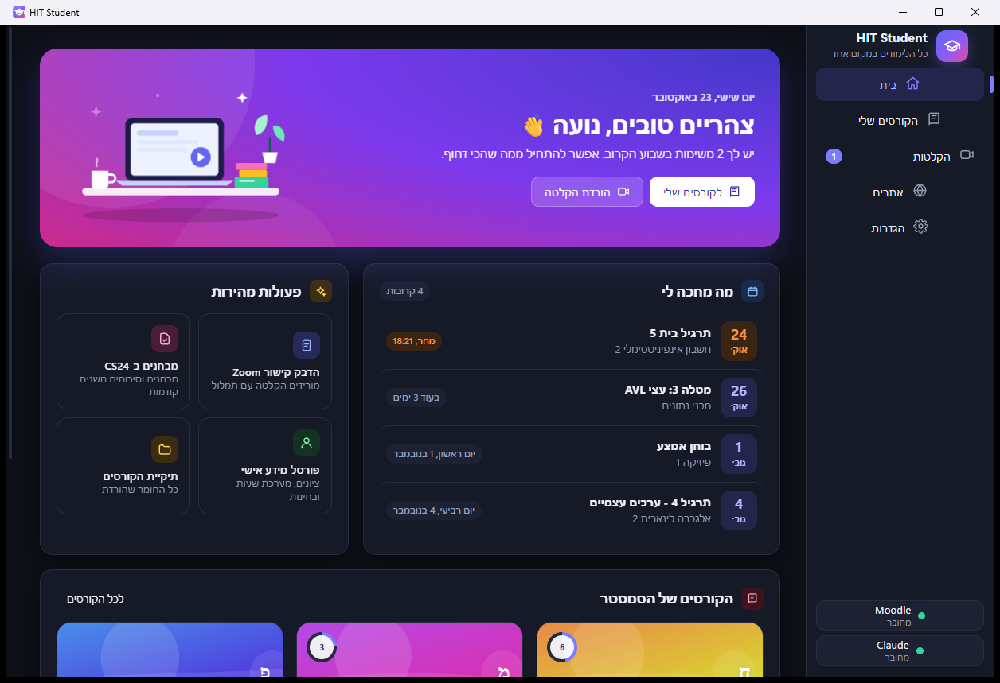
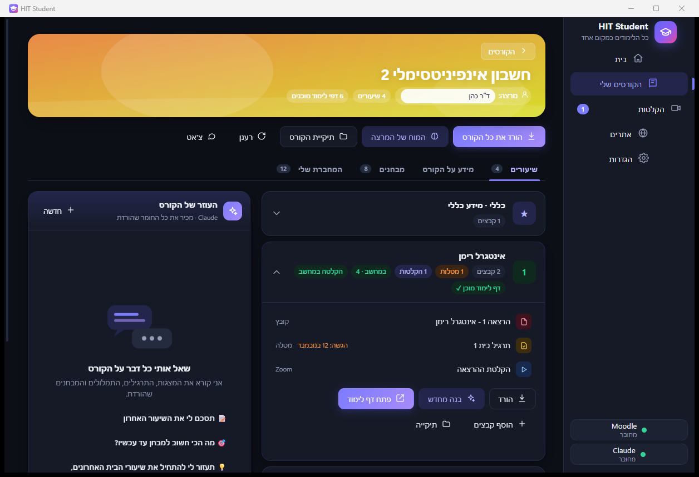
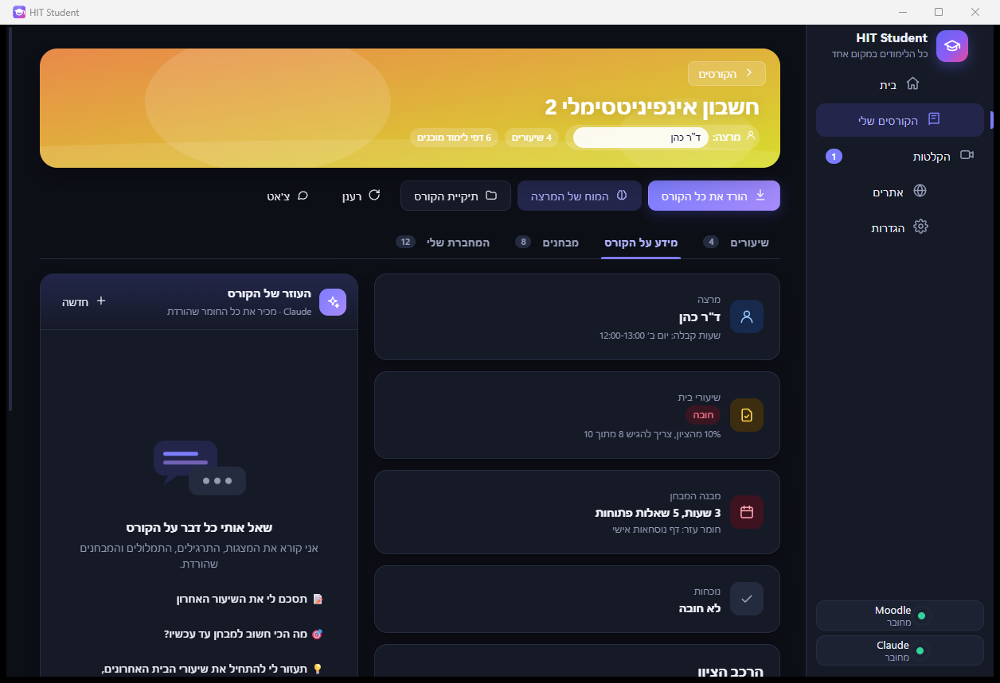
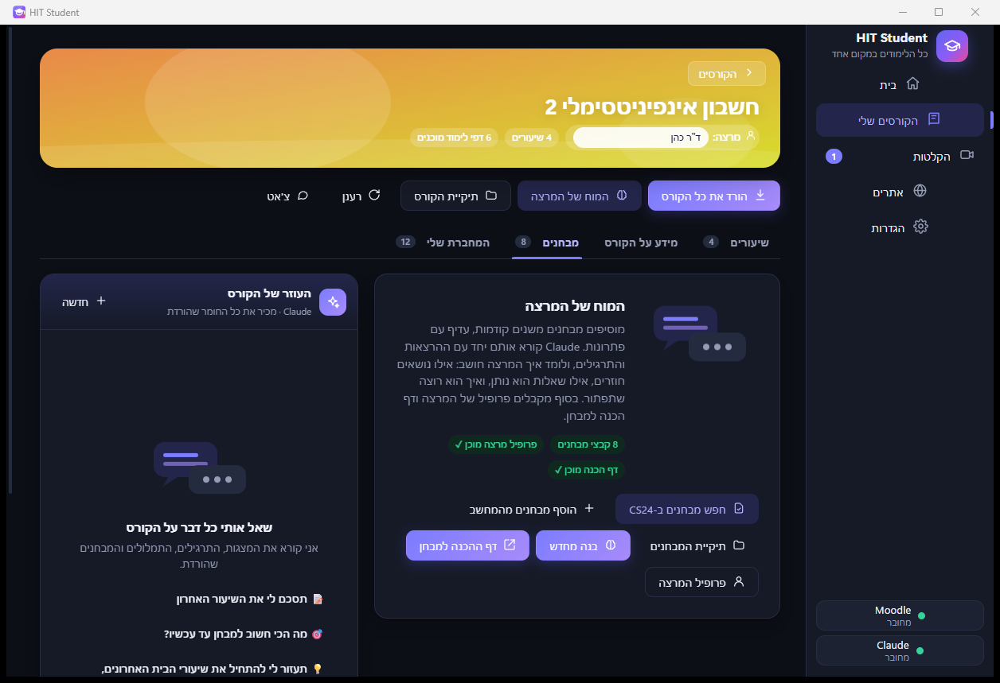
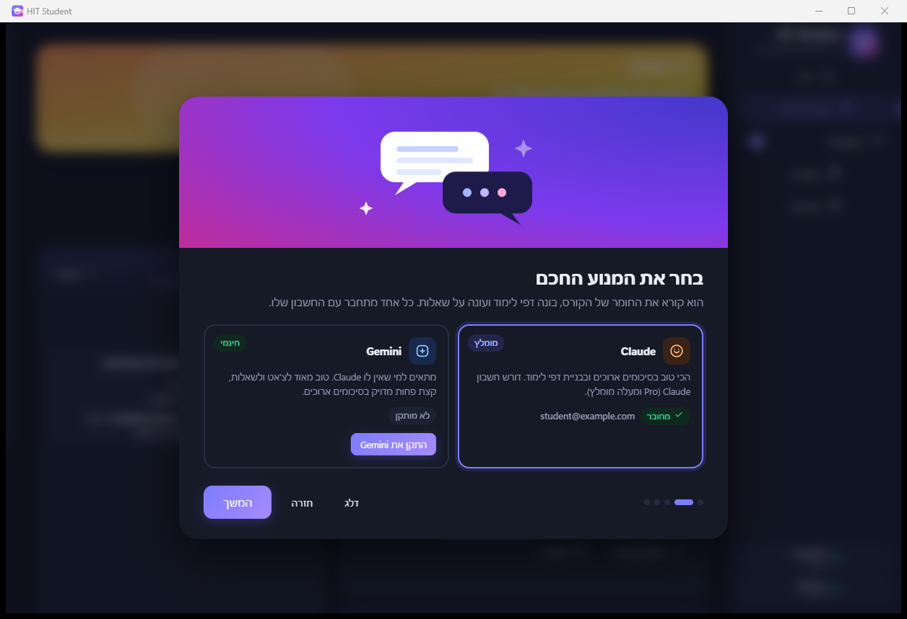

<div dir="rtl" align="center">


# SumIT

**כל הלימודים ב-HIT באפליקציה אחת.** הקורסים מה-Moodle, ההקלטות מה-Zoom והחומר מ-CS24, ולכל הרצאה קובץ PDF אחד: סיכום של כל ההרצאה יחד עם שיעורי הבית ואיך לענות עליהם.



</div>

<div dir="rtl">

## מה יש בה

- **מסך בית:** מה מחכה לך השבוע (מטלות ומועדים מה-Moodle), הקורסים של הסמסטר, ופעולות מהירות.
- **הקורסים שלי:** כל קורס עם כל השיעורים, הקבצים, המטלות וההקלטות שלו.
  - **בפעם הראשונה** האפליקציה שואלת כמה שאלות, ואז מורידה הכל בלחיצה אחת (Moodle ו-CS24), עם אחוזים ומה היא עושה עכשיו. בזמן ההורדה אפשר להתחיל קורס אחר.
  - **סיכום PDF לכל הרצאה:** סיכום מפורט של כל החומר של ההרצאה, ואחריו שיעורי הבית: לכל שאלה - לאיזה חלק בסיכום היא קשורה ואיך המרצה מצפה שיענו עליה (לפי הפתרונות שלו ומבחנים קודמים), ודפי התרגיל עם רמזים אדומים בשוליים. נבנה לפי שיטת [course-study-builder](https://github.com/ariel853/studenting_with_ai).
  - **חומר חדש:** כשהמרצה מעלה משהו חדש ל-Moodle, האפליקציה מזהה את זה ושואלת אם להוריד ולעדכן את הסיכום.
  - **מידע על הקורס:** ניתוח של הסילבוס, כולל מרצה, הרכב הציון, האם שיעורי הבית חובה, מבנה המבחן ותאריכים.
  - **הכנה למבחן:** מהמבחנים משנים קודמות (מה-Moodle ומ-CS24) האפליקציה לומדת איך המרצה חושב ובוחן, ובונה דף הכנה למבחן.
  - **המחברת שלי:** הדפים שכתבת ב-Notability נכנסים לקורס ולסיכומים.
  - **צ'אט:** אם בכל זאת משהו לא ברור, אפשר לשאול על החומר.
- **הקלטות Zoom:** מדביקים קישור ומקבלים את הסרטון ואת התמלול בעברית (`<שם> תמלול.txt`).
- **אתרים:** Moodle, פורטל מידע אישי ו-CS24 בתוך האפליקציה. קבצים שמורידים נשמרים ישר לקורס שבחרת.
- **AI:** עובד עם Claude. Gemini - בקרוב.

<div align="center">
 
 
</div>

## התקנה

1. נכנסים ל-[Releases](../../releases) ומורידים את `HIT-Student.zip`.
2. מחלצים לתיקייה כלשהי (למשל `D:\HIT`).
3. מפעילים את `HitStudent.exe`.

בפעם הראשונה ש-Windows מציג "Windows protected your PC", לוחצים **More info** ואז **Run anyway**. ההודעה מופיעה כי התוכנה לא חתומה דיגיטלית.

בפתיחה הראשונה מסך פתיחה קצר מחבר את הכל: המנוע החכם, Moodle ותיקיית החומר. אין חלונות שחורים ואין פקודות.

## המנוע החכם: Claude או Gemini

| | Claude | Gemini |
|---|---|---|
| מחיר | דורש חשבון Claude (Pro ומעלה מומלץ) | חינמי, עם מפתח מ-Google AI Studio |
| דפי לימוד וסיכומים ארוכים | מצוין | טוב |
| צ'אט ושאלות | מצוין | טוב מאוד |
| חיבור | לוחצים "התקן והתחבר", ומאשרים בדפדפן | לוחצים "התקן", מדביקים מפתח חינמי |

## Notability

ב-Notability באייפד: **הגדרות › גיבוי אוטומטי** › בוחרים Google Drive, OneDrive או Dropbox, בפורמט **PDF**. מתקינים את אותו שירות במחשב, כדי שתיקיית הגיבוי תסתנכרן. אחר כך בוחרים אותה בהגדרות של HIT Student, ובכל קורס בוחרים את הנושא המתאים ב-Notability.

## איך זה מסודר במחשב

```
D:\HIT\Courses\
  <שם הקורס>\
    שיעור 1\              מצגות וקבצים
      תרגילים\            תרגילים, פתרונות ומטלות
      הקלטה\              שיעור 1.mp4 + שיעור 1 תמלול.txt
    מבחנים\               מבחנים משנים קודמות
    מידע על הקורס\        סילבוס
    מחברת\                הדפים מ-Notability
    דפי לימוד\            שבוע-1.html, לקראת המבחן.html
    פרופיל המרצה.md
```

## פרטיות ואבטחה

- ההתחברות ל-HIT נשמרת רק במחשב שלך (`browser-data` שליד האפליקציה). שום דבר לא נשלח לשרת שלנו, כי אין כזה.
- האפליקציה לא פותחת אף פורט ברשת, ולא ניתן להתחבר אליה מבחוץ.
- ה-AI עובד רק בתיקיית הקורס, בלי גישה לאינטרנט ובלי אפשרות להריץ פקודות מערכת.
- פרטים מלאים ב-[SECURITY.md](SECURITY.md).

## שימוש הוגן

הכלי נועד ללמידה אישית. אם מרצה כיבה את הורדת ההקלטות, כבדו את זה: אל תפיצו ואל תעלו הקלטות או חומרי קורס לשום מקום.

## בנייה מהקוד

```powershell
powershell -ExecutionPolicy Bypass -File build.ps1
```

הסקריפט מוריד את ה-WebView2 SDK של Microsoft, מקמפל עם הקומפיילר של .NET Framework שמגיע עם Windows, ושם את התוצאה ב-`dist\`.

בדיקה מלאה (מתחבר ל-Moodle ול-Claude האמיתיים שלך):

```powershell
& "dist\HIT Student\HitStudent.exe" --selftest report.json
```

</div>
